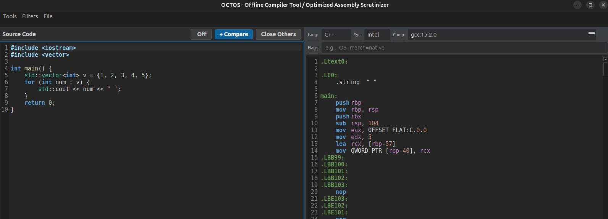

<div align="center">
  

  # OCTOS
  **Offline Compiler Explorer & Assembly Analyzer**

  [](#project-status)
  [](https://octos.readthedocs.io/en/latest/)
  [](LICENSE)
  [](https://en.wikipedia.org/wiki/C%2B%2B)
  [](https://www.qt.io/)
  [](https://www.docker.com/)

  
</div>

---

## Overview

**OCTOS** is a desktop application for studying and optimizing compiled code. Write code in multiple programming languages, compile it locally in isolated Docker environments, and scrutinize generated machine instructions, bytecode, or disassembly side-by-side.

By utilizing containerized compilers, OCTOS eliminates complicated host-system toolchain installations while preventing unsafe host execution through strict sandboxing (`--network none`, resource limits, dropped capabilities, and read-only source inputs).

## Major Features

- **Isolated Local Compilation**: Compiles locally inside dedicated Docker containers without transmitting source code to external servers.
- **Side-by-Side Comparison**: Open multiple compiler panes to compare optimization flags (`-O0`, `-O1`, `-O2`, `-O3`, `-Os`), different compiler versions, or syntax flavors (`Intel` vs `AT&T`).
- **High-Performance Assembly Diff**: Scalable Myers diff with prefix/suffix trimming, normalization, row jump navigation, and `.patch` unified diff export.
- **Opcode Reference & Analysis**: Interactive x86-64 and ARM64 instruction tooltips with flags and syntax breakdown.
- **Decoupled Architecture**: Modular `octos_core` library separating language compilation strategies, security-hardened Docker backends, and revision-aware job scheduling.
- **Robust Job Lifecycle**: Concurrency-safe compilation queue with thread-confined worker processes, atomic cancellation, debounce timers, timeouts, and leak-free container cleanup.
- **Assembly Visualization & Filtering**: Real-time filtering for CFI directives, segment/data directives, metadata labels, and comments, with C++ demangling and source-to-assembly line mapping.
- **Full File Management**: Dirty-state tracking, save confirmation dialogs, recent files history, and workspace model serialization.

## Language & Compiler Support Matrix (v0.4.1)

| Language | Status | Compilation Target | Supported Compilers & Tools | Notes |
| :--- | :--- | :--- | :--- | :--- |
| **C / C++** | **Supported** | Native Machine Assembly | GCC (`gcc`, `g++`), Clang (`clang`, `clang++`) | Supports Intel and AT&T syntax, optimization flags, debug info |
| **Rust** | **Supported** | Native Machine Assembly | `rustc` (`--emit=asm`) | LLVM Intel/AT&T asm syntax, opt-level, debuginfo |
| **Java** | **Supported** | JVM Bytecode | OpenJDK / Temurin (`javac` + `javap`) | Automatically detects public classes, disassembles bytecode |
| **Python** | **Supported** | CPython Bytecode & Syntax | CPython (`python3`, `py_compile`, `dis`) | Safe compilation into output workspace, disassembles bytecode |
| **C#** | **Experimental** | CIL / Intermediate Language | Mono (`mcs` + `monodis`) | Requires Mono container with disassembler |
| **Ada** | **Planned** | Native Assembly | GNAT (`gcc`) | Requires GNAT toolchain container |

## Quick Start

### Prerequisites
- **Docker** installed and running
- **CMake** (3.16+) and **Qt 6** (Core, Widgets, Gui, Network, Test)
- **C++17** compatible compiler (GCC 9+, Clang 10+, Apple Clang, or MSVC 2019+)

### Build and Run

```bash
git clone https://github.com/MichaelWeissDEV/OCTOS.git
cd OCTOS
mkdir build && cd build
cmake .. -DCMAKE_BUILD_TYPE=Release -DBUILD_TESTING=ON
cmake --build .
./OCTOS
```

### Running Automated Tests

OCTOS features a comprehensive automated test suite decoupled from Docker daemon dependencies:

```bash
ctest --test-dir build --output-on-failure
```

Tests include compiler strategy flag generation, user argument sanitization, assembly filtering, source-to-assembly mapping, job scheduling and cancellation, Docker security parameters, and configuration persistence.

## Documentation

Full documentation is available under `docs/` and can be served locally via `mkdocs serve`:
- **[Getting Started](docs/getting-started.md)**: First-time setup and tutorial.
- **[Architecture](docs/development/architecture.md)**: Deep dive into `octos_core`, strategy patterns, and job lifecycle.
- **[Docker Backend & Security](docs/development/docker-backend.md)**: Security sandbox, container lifecycle, and resource constraints.
- **[Compiler Support](docs/compilers/index.md)**: Matrix and container details.
- **[Limitations](docs/limitations.md)**: Known constraints and planned features.

## License

This project is licensed under the **MIT License** - see the [LICENSE](LICENSE) file for details.
